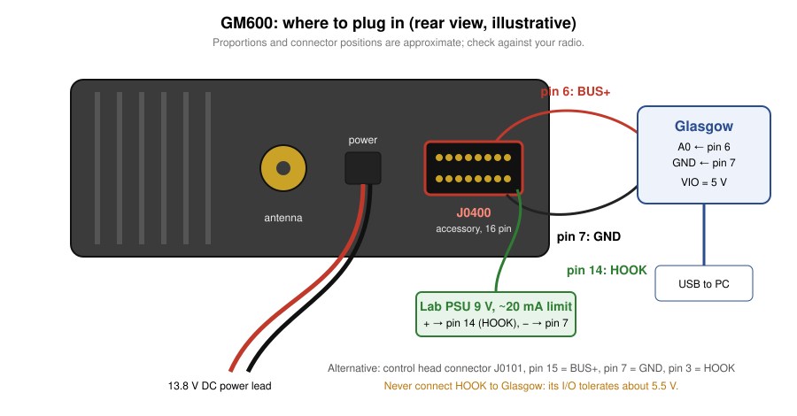
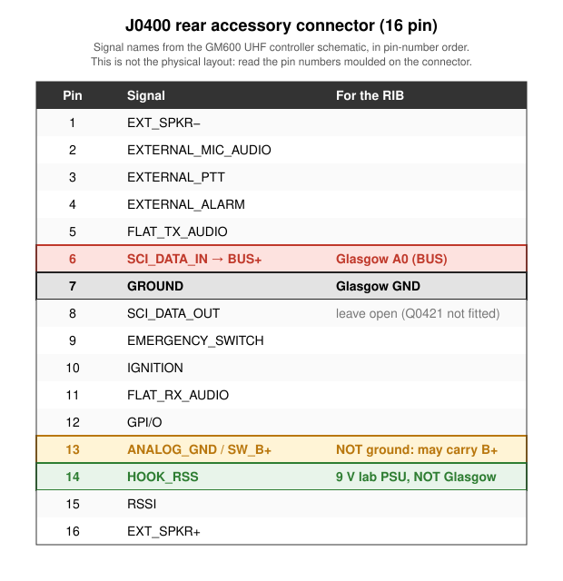
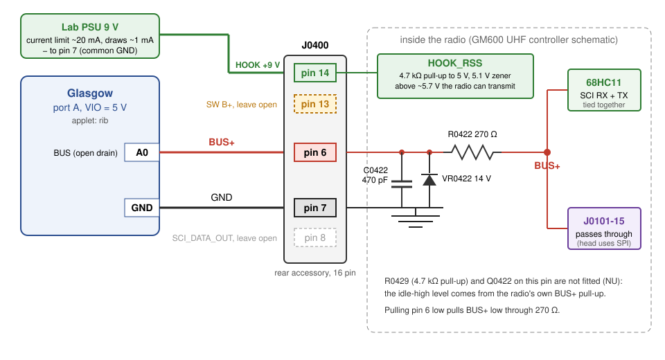

# Connecting the Glasgow RIB to a GM600

How to wire the `glasgow_rib` applet to a GM600 (600 Series, MPT1327 trunked mobile) for
programming. The protocol itself is in [PROTOCOL.md](PROTOCOL.md).

Pin and signal names come from the GM600 UHF controller schematic (`docs/motorola_gm600_uhf_sm.pdf`,
drawing 8402626Y07; crops in `docs/render/`).



## Summary

| Glasgow | GM600 rear accessory connector J0400 |
|---|---|
| A0 (`--bus`) | **pin 6**: SCI_DATA_IN, connected to BUS+ |
| GND | **pin 7**: GROUND |

- Set Glasgow I/O voltage to **5 V**.
- Nothing else is needed: no level shifter, no diode, no BUSY line.
- The applet drives BUS+ open drain, the same way the radio and control head do.

## J0400 pinout



| Pin | Signal | Notes |
|---|---|---|
| 1 | EXT_SPKR− | |
| 2 | EXTERNAL_MIC_AUDIO | |
| 3 | EXTERNAL_PTT | |
| 4 | EXTERNAL_ALARM | |
| 5 | FLAT_TX_AUDIO | |
| **6** | **SCI_DATA_IN → BUS+** | **RIB data line** |
| **7** | **GROUND** | **RIB ground** |
| 8 | SCI_DATA_OUT | Leave open: driver Q0421 and pull-up R0428 are not fitted |
| 9 | EMERGENCY_SWITCH | |
| 10 | IGNITION | |
| 11 | FLAT_RX_AUDIO | |
| 12 | GPI/O | |
| 13 | ANALOG_GND / SW_B+ | **Not a ground.** May carry switched battery voltage |
| 14 | HOOK | |
| 15 | RSSI | |
| 16 | EXT_SPKR+ | |

The physical arrangement of the pins on the connector face is not in the schematic. **Go by
the numbers moulded on the connector**, and confirm with a meter (see below) before you connect
anything.

## What is behind pin 6



```
J0400-6 ──┬──┬── R0422 270 Ω ── BUS+ ──┬── 68HC11 SCI (RX and TX tied together)
          │  │                         └── J0101-15 (control head)
     C0422  VR0422
     470 pF 14 V
          │  │
GND ──────┴──┴── J0400-7
```

- Pin 6 is BUS+ itself, through a 270 Ω series resistor. A 470 pF capacitor and a 14 V zener
  protect it.
- The radio's CPU sends and receives on the same BUS+ line, so everything on it, including
  your own bytes, is seen by every device. That is why the applet echoes your transmitted bytes
  back.
- The optional 4.7 kΩ pull-up (R0429) and transistor (Q0422) on this pin are marked NU (not
  fitted). The line idles high because of the radio's own BUS+ pull-up, not because of anything
  on the connector.
- When you pull pin 6 low, the radio sees BUS+ go low through 270 Ω. Against a pull-up of a
  few kΩ that is still a clean low.

## Before you connect: check with a meter

With the radio **off**:

1. Pin 7 to chassis: about 0 Ω.
2. Pin 6 to control head connector J0101-15 (or to the BUS+ test point): about 270 Ω. This
   confirms R0422 is fitted on your board variant.

With the radio **on**:

3. Pin 6 to pin 7: about 5 V when the bus is idle. You may see it flicker while the radio
   talks to the control head.
4. Pin 13 to pin 7: if it reads battery voltage, keep well away from it.

## Running the applet

The applet is not registered with Glasgow yet. Add it to the `glasgow.applet` entry points
(for example in Glasgow's `software/pyproject.toml`), then reinstall Glasgow in this venv:

```toml
[project.entry-points."glasgow.applet"]
rib = "glasgow_rib:RIBApplet"
```

Then:

```sh
# Watch the bus without transmitting; good first check
glasgow run rib -V 5 --bus A0 sniff

# Expose the bus as a pseudo-terminal (for DOSBox-X directserial, 86Box, or your own CPS)
glasgow run rib -V 5 --bus A0 pty

# Expose the bus as a TCP socket
glasgow run rib -V 5 --bus A0 socket tcp:localhost:2323
```

The default baud rate, 9600, is the only one the 600 Series uses. Leave `--busy` off: the
GM600 has no BUSY line.

## Alternative: control head connector J0101

BUS+ is also on the internal control head connector J0101:

| J0101 pin | Signal |
|---|---|
| 15 | BUS+ |
| 7 | GND |
| 18 | ON_OFF_CONTROL (control head service request, see below) |

The control head is always on BUS+, so expect its traffic in `sniff` whichever connector you
use. If you later want to emulate control head button presses, you will also need
ON_OFF_CONTROL. In the GM340-family service manual (`docs/gm-manual.txt` §2.4) it sits low and
the control head signals a request by pulling it **high**, so it needs a pull-up driver, not
open drain. The same line also switches the radio on and off. Not yet confirmed for the GM600.

## Unverified

- Physical pin positions on J0400 (use the moulded numbers).
- That R0422 is fitted on every board variant (check step 2 above).
- The value of the radio's BUS+ pull-up, which sets how clean your low level is. Scope it once.
