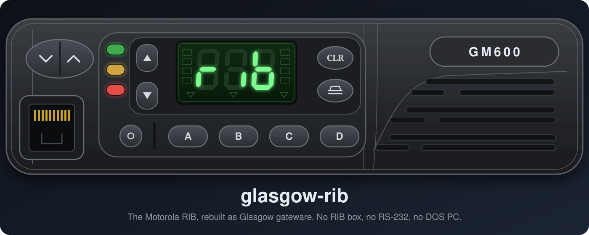
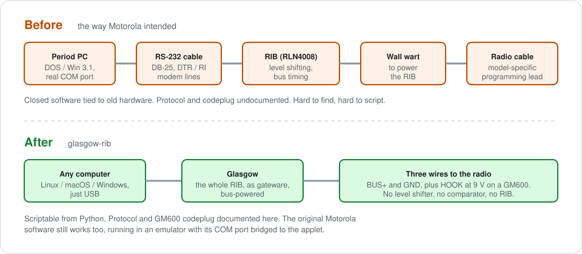
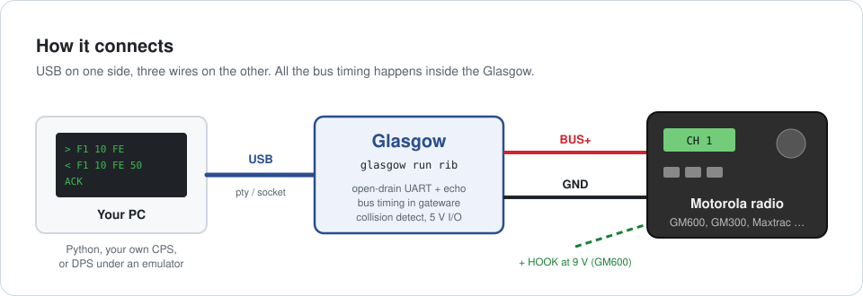
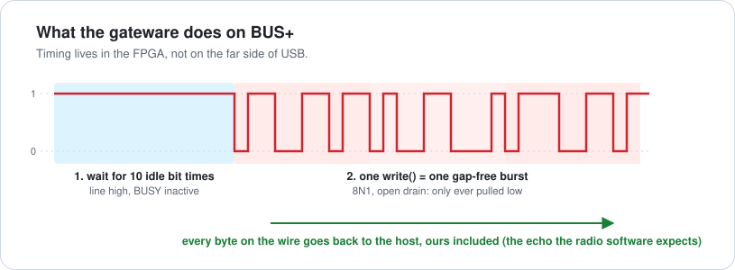

<p align="center">
  
</p>

<p align="center">
  <b>A <a href="https://glasgow-embedded.org/">Glasgow</a> applet that replaces the Motorola RIB.</b><br>
  Talk to the SB9600 / SBEP bus of Motorola radios over USB, with three wires and no adapter box.
</p>

<p align="center">
  <a href="#quick-start-gm600">Quick start</a> ·
  <a href="#how-it-works">How it works</a> ·
  <a href="#supported-radios">Supported radios</a> ·
  <a href="gm600/README.md">GM600 docs</a>
</p>

---

## Why this matters

For decades, programming a Motorola radio of this era meant a **RIB** (Radio Interface Box,
RLN4008): a powered box between an RS-232 port and the radio, doing level shifting and the bus
timing that the radio insists on. You also needed a PC old enough to have a real serial port,
with modem control lines, to run DOS or Windows 3.1 programming software.

<p align="center">
  
</p>

glasgow-rib turns that whole chain into gateware on a Glasgow:

- **No RIB, no RS-232, no level shifter.** Glasgow's I/O runs at 5 V and drives the bus open
  drain, exactly like the radio does. BUS+ and ground are the only signal wires.
- **The timing lives in the FPGA.** The radio drops a message if its bytes are more than about
  2 ms apart, which USB can't promise. The gateware waits for an idle bus, sends each message as
  one gap-free burst, and detects collisions bit by bit.
- **Scriptable.** Use it from Python, expose it as a pty or a TCP socket, or write your own CPS
  on top of it.
- **The original software still works.** Motorola's GM600 Dealer Programmer (16-bit Windows 3.1)
  has read and written a real radio through this applet, running in QEMU with its COM port bridged
  to the applet's socket.
- **Documented, not just working.** For the GM600, the programming protocol, the 640-byte codeplug
  format, the frequency encoding and the firmware's memory map are all written up in
  [gm600/](gm600/README.md), with a Kaitai spec and host tools.

## What works today

| | Status |
|---|---|
| **GM600** | ✅ Read and write on a real radio (Glasgow revC3). Codeplug decoded: channels, PL tones, MPT identity, options |
| GM300 / GM338, Maxtrac, GTX, Radius, GP300 / GP350 | 🟡 Should work (single-wire BUS+), untested |
| Radios with a BUSY line | 🟡 BUSY support is in the gateware, tested in simulation only |
| Differential BUS+ / BUS− radios (Syntor X9000, Spectra, Astro Spectra) | ❌ Not supported: no BUS− pin |

## Quick start (GM600)

**You need:** a [Glasgow](https://glasgow-embedded.org/) (revC), three wires, and a bench supply
set to 9 V with a current limit. That's all: no RIB, no MAX232, no comparator, no diode.

1. **Wire it up** (rear accessory connector J0400; check the pins with a meter first, see
   [gm600/CONNECTION.md](gm600/CONNECTION.md)):

   | From | To J0400 |
   |---|---|
   | Glasgow **A0** | pin **6** (BUS+) |
   | Glasgow **GND** | pin **7** (GND) |
   | Bench supply **+9 V** (current limit 10–20 mA) | pin **14** (HOOK) |
   | Bench supply **−** | pin **7** (GND) |

   HOOK at about 9 V is what puts the radio into programming mode. Without it, the radio hears
   you but never answers. **Never connect HOOK to a Glasgow pin.**

2. **Install** (see [Install](#install) below), then start the applet as a socket:

   ```sh
   glasgow run rib -V 5 --bus A0 socket tcp:127.0.0.1:2324
   ```

3. **Dump the codeplug:**

   ```sh
   python3 gm600/tools/dump_codeplug.py my-radio.bin
   ```

   That reads all 640 bytes, checking every reply's checksum. **Keep this first dump**: it's your
   backup before anything writes to the radio.

4. **Decode it:** open `my-radio.bin` with [gm600/gm600_codeplug.ksy](gm600/gm600_codeplug.ksy)
   in the [Kaitai Web IDE](https://ide.kaitai.io/), or read [gm600/CODEPLUG.md](gm600/CODEPLUG.md).

## How it works

<p align="center">
  
</p>

<p align="center">
  
</p>

The applet is a half-duplex, open-drain 8N1 UART with an optional BUSY line:

- **BUS+** is open drain. The applet only pulls it low or releases it, and reads back the
  wired-AND of everyone on the bus.
- **Echo:** every byte on the line goes to the host, including the applet's own, as with a real
  RIB. Motorola's programming software checks this echo.
- **Atomic bursts:** a transmission starts only after the bus has been idle (line high, BUSY
  inactive) for one packet time, which is 10 bit times. Bytes queued together then go out back to
  back.
- **Collision detection:** every released (1) bit is checked at mid-bit. If the line reads 0, the
  applet releases the bus, discards the rest of the queued burst and counts a collision.
- **BUSY** (optional) is open drain and active low by default; `--busy-active high` switches the
  polarity. The input is glitch filtered over 1/8 of a bit time. BUSY has three modes:
  - `auto` (default): asserted `--busy-setup` bit times before the first start bit, and released
    `--busy-hold` bit times after the burst.
  - `manual`: driven from a register.
  - `none`: not driven.

## Supported radios

The applet speaks the **single-wire** variant of the bus: BUS+ only, plus BUSY if the radio has
one.

- **Tested: GM600.** Reads, writes and a full DPS read/write session on a real radio. Everything
  GM600-specific is in [gm600/](gm600/README.md).
- **Should work (BUS+ only), untested:** the radios that RIBless cables are sold for: GM300 /
  GM338, Maxtrac, GTX, Radius mobiles, GP300 / GP350. Most of these don't use BUSY.
- **Not supported: differential BUS+ / BUS− radios.** These are the Systems 9000 family: Syntor
  X9000 / X9000E, Spectra, Spectra II and Astro Spectra. They use both BUS+ and BUS− at the
  radio. The RIB handles the pair (homebrew RIBs use an LM311 comparator for it), and for
  BUS+-only radios a jumper in the cable's DB-25 shell stands in for BUS−. This applet has no
  BUS− pin.
- **Check the service manual first:** for other SB9600 radios (MCS2000, MTS2000, Astro 25 /
  XTL), see whether the programming port carries BUS− as well as BUS+.

Supporting the differential radios would take a second pin driving BUS− as the inverse of BUS+,
and the radio's BUS− voltage levels have to be checked first. Nothing in the gateware rules it
out.

Got another radio working? Each radio gets its own folder (like [gm600/](gm600/README.md)) with
its wiring, protocol notes and tools.

## Install

The applet uses Glasgow's current applet API (V2), so build against Glasgow from git:

```sh
git clone https://github.com/GlasgowEmbedded/glasgow.git
python3 -m venv .venv
.venv/bin/pip install -e "glasgow/software[builtin-toolchain]"
.venv/bin/pip install --no-deps -e .          # this repo
export GLASGOW_OUT_OF_TREE_APPLETS=I-am-okay-with-breaking-changes
.venv/bin/glasgow run rib --help
```

## Usage

```sh
# GM600: BUS+ on A0, 5 V
glasgow run rib -V 5 --bus A0 sniff                         # passive, timestamped hex per message
glasgow run rib -V 5 --bus A0 pty                           # prints /dev/pts/N
glasgow run rib -V 5 --bus A0 socket tcp:127.0.0.1:2324     # one TCP client at a time

# SB9600 radio with BUSY on A1
glasgow run rib -V 5 --bus A0 --busy A1 --busy-setup 1 --busy-hold 10 sniff
```

From Python (`glasgow repl rib …` or your own app), via the applet's `RIBInterface`:

```python
iface = applet.rib_iface
frame = bytes.fromhex("F1 10 FE")
echo = await iface.transfer(frame, timeout=0.5)  # write + read back the echo
if echo != frame: ...                            # collision (short echo or wrong bytes): retry
ack = await iface.read(1)                        # 50 = ACK, 60 = NAK
await iface.get_busy()
```

Every byte written in one `write()` is one burst on the bus. **Send one whole message per call.**

## Repository layout

| Path | What |
|---|---|
| [`glasgow_rib/`](glasgow_rib/) | The applet: gateware, host interface, simulation tests |
| [`gm600/`](gm600/README.md) | Motorola GM600: wiring, protocol, codeplug, firmware notes, Kaitai spec, tools |
| [`assets/`](assets/) | Images for this README |

## Limitations

- Only the GM600 has been tested on hardware. It has no BUSY line, so the BUSY handling (`--busy`,
  the auto/manual modes, setup/hold, polarity) has only been tested in simulation.
- A pty carries no modem control lines. RSS versions that toggle DTR and expect BUSY back on
  RI/CTS won't see it. The applet targets host software that uses this API, or a socket bridge.
- `sniff` timestamps come from the host, so they are only accurate to a few milliseconds.
- The GM600 work covers the codeplug, not the radio's firmware. Writing a modified codeplug also
  needs correct checksums, which aren't fully pinned yet; see [gm600/README.md](gm600/README.md).

## Tests

```sh
python -m unittest glasgow_rib.test
```

Simulation tests cover echo, gap-free bursts, waiting for an idle bus, BUSY in auto mode,
deferring to an external BUSY, and collision abort. The synthesis tests run when a toolchain is
available (`glasgow[builtin-toolchain]`).

Reference material (service manuals, schematics) goes in `docs/`, which is gitignored.

---

<sub>The radio artwork is a redraw of the front-panel line drawing in the GM600 user guide. Motorola
is a trademark of its owner; this project is not affiliated with Motorola Solutions.</sub>
