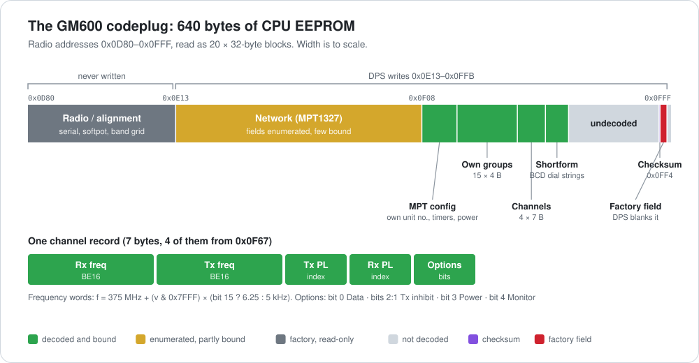

# GM600 codeplug decode

The whole GM600 codeplug is the **640-byte 68HC11 internal EEPROM, radio `0x0D80`–`0x0FFF`**
(read with 20 × 32-byte `11` reads; see [PROTOCOL.md](PROTOCOL.md)). DPS expands it into a
`0x7F1`-byte `.per`/`.rad` file, but the radio stores only these 640 packed bytes. Offsets below
are radio addresses. Ground truth: a live DPS "Read Radio" of serial `807IYA0903`, model
`M08RHF4CK3`, plus write-probes driven by the tools in [tools/](tools/) (2026-11-03).

## Block layout

<p align="center">
  
</p>

| Range | Block | R/W | Contents |
|---|---|---|---|
| `0x0D80`–`0x0E12` | Radio / alignment | **read-only** (never rewritten) | serial `807IYA0903CG` (ASCII @ `0x0D88`), band-cal / tuning-grid words (@ `0x0DDA`), softpot |
| `0x0E13`–`~0x0F07` | Network (MPT1327) | read-write | trunking/network parameters — **field set fully enumerated, byte-offsets partly bound** (Control Channel List `0x0E5F`, Channel Frequency Plan `0x0EB0`) |
| `~0x0F08`–`0x0FF4` | Personality | read-write | MPT numbers incl. own-number, timers, power (`0x0F08`–`0x0F2A`); Own Group list (`0x0F2B`–`0x0F66`); channel table (`0x0F67`–`0x0F82`); Shortform Dialling (`0x0F83`–`0x0F99`); undecoded rest; checksum byte `0x0FF4` |
| `0x0FF5`–`0x0FFB` | Factory field | blanked by DPS | see "DPS clears a 7-byte trailing field" |
| `0x0FFC`–`0x0FFF` | — | untouched | never written by DPS |

Exact offsets for every bound field are in [gm600_codeplug.ksy](gm600_codeplug.ksy). The five
block boundaries are pinned by the solved per-block checksums (see "Checksums — solved" below);
any remaining `~` on a sub-field boundary comes from field positions, not the block checksum.

DPS's write touches only `0x0E13`–`0x0FFB`; `0x0D80`–`0x0E12` (serial + alignment) and
`0x0FFC`–`0x0FFF` are left alone.

## Channel table — `0x0F67`, 7-byte records

**Fixed 4 entries on the GM600** (`0x0F67`–`0x0F82`). There is **no reliable terminator**: `0x0F83`
begins the Shortform Dialling buffer, whose `0xF`-nibble padding merely *looks* like a `0xFFFF`
end-marker (a coincidence that breaks as soon as a dial string grows).

| +off | field | encoding | status |
|---|---|---|---|
| +0 | Rx freq | BE16, `375.000 MHz + (v&0x7FFF)×(bit15?6.25:5 kHz)` | confirmed |
| +2 | Tx freq | BE16, same formula (`==Rx` for simplex) | confirmed |
| +4 | Tx PL | tone-list index, 0 = none (ch4 = `0x13` = 19 = 123.0 Hz) | confirmed |
| +5 | Rx PL | tone-list index, 0 = none | confirmed |
| +6 | options | bitfield (see table below): bit0 Data, bits2:1 Inhibit, bit3 Power, bit4 Monitor | bound |

Frequency formula detail and per-channel proof: [FREQ_ENCODING.md](FREQ_ENCODING.md). PL/TPL tone
index table: the `pl_tone` enum in [gm600_codeplug.ksy](gm600_codeplug.ksy) (source: motorola-cps
`docs/.../FIELD_HELP_REFERENCE.md`).

This radio: 4 channels at `0x0F67/0x6E/0x75/0x7C`. `0x0F83` onward is the Shortform buffer: its
`FF` padding reads like a `0xFFFF` Tx word, but it is not a channel terminator.

## Other decoded fields

- **MPT own-number (identity):** BE16 at `0x0F0B` = `0x0142` = **322** (field `MPT1327_OWN_IDENT`).
- **Serial:** ASCII `807IYA0903CG` at `0x0D88` (also returned by `23 01`).
- **Transmit timeout:** enabled + duration 10 s (GUI), stored in the personality block.

## Complete field inventory (static)

All **195 codeplug fields** (MPT1327 network/trunking, personality, and RF alignment) are
enumerated by symbolic name + type-category + attribute-flags, recovered statically from the
field-registry table in the DPS binary (`WDPS_DP.EXE`). This is the authoritative list of *what*
the codeplug stores; exact byte/bit offsets are bound separately (write-contrast or transform RE).
Full table: motorola-cps `docs/DPS_EMEA_600SERIES_R00.03.02/FIELD_DICTIONARY.md`. The network block
is editable in `WDPS_DP.EXE` (which also does Read/Write Radio), so the proven GUI-edit→write→dump→diff
method applies to it just as it did to the personality options.

## Checksums — solved

DPS checks one checksum per block when it reads the radio, and rejects the whole read on a
mismatch with a block-specific message: `Radio / Network / Personality Data Checksum Failure`.
The radio itself validates on boot (a bad checksum shows an error display); over SBEP every `17`
still gets `84` (OK) whatever the data, so nothing stops you writing a codeplug DPS will later reject.

**There are five per-block additive checksums.** Each checksum byte sits immediately after its
block's data and equals:

```
checksum = (sum(block_data_bytes) − 0x55) & 0xFF
```

Reversed from the radio firmware (`motofix.BIN`): the per-block validator at `0xB8E1`/`0xB900` sums
each block byte-by-byte and checks `stored == 0xAA − ~sum` (= `sum − 0x55`). The `0x55` is a firmware
constant. Confirmed against the live `native-eeprom.bin` (all five blocks) and in the 68HC11
emulator (a wrong checksum shows the error display; the corrected image boots normally).

| Block | Data range (radio addr) | Checksum byte | DPS message on mismatch |
|---|---|---|---|
| Serial / header 1 | `0x0D80`–`0x0D84` | `0x0D85` | *(read-time, factory region)* |
| Header 2 | `0x0D86`–`0x0D92` | `0x0D93` | |
| **Radio** | `0x0D94`–`0x0E11` | `0x0E12` | `Radio Data Checksum Failure` |
| **Network** | `0x0E13`–`0x0F06` | `0x0F07` | `Network Data Checksum Failure` |
| **Personality** | `0x0F08`–`0x0FF3` | `0x0FF4` | `Personality Data Checksum Failure` |

Consistent with the earlier contrast probes: changing `0x0F06` gave `Network Data Checksum Failure`
(it's the last Network data byte), and the channel region `0x0F6D`–`0x0F74` and Monitor bit sit in
the Personality block (raising a channel byte by `0x10` raised `0x0FF4` by `0x10`).

**`0x0FF5`–`0x0FFF` is outside every block** — it follows the last checksum byte (`0x0FF4`) and is
summed by nothing. This is the 7-byte factory field DPS blanks to `FF` on write (see below); because
it is not in any block, blanking it does not disturb a checksum.

To write a modified codeplug, recompute the affected block's checksum.
[`tools/gm600_codeplug.py`](tools/gm600_codeplug.py) does this (`verify_checksums`, `fix_checksums`,
and a `--fix` CLI), and [`tools/sbep_write.py`](tools/sbep_write.py) verifies all five before a
`--write` and refuses (or, with `--fix`, repairs) any write that would leave a block wrong.

## DPS clears a 7-byte trailing field on write

DPS's captured write changed exactly **7 bytes** beyond re-writing the data: `0x0FF5`–`0x0FFB`,
from `20 00 00 00 00 11 DC` in the factory image to `FF FF FF FF FF FF FF`. Likely a
programming-history / flag / counter field (`11 DC` looks like a value, not padding). Consequences:

- `tools/sbep_write.py --restore` replays DPS's captured write, so it restores the **post-DPS**
  state (`FF` here) — **not** the factory original.
- The factory bytes survive only in the **pre-write dumps** (`native-eeprom.bin`, and the lab's
  `docs/gm600-807IYA0903-2026-11-03-alignment-0D80.bin`) — keep them.
- What those 7 bytes encode: **factory/firmware-owned data, not DPS-managed** (investigated
  2026-11-04). Framing `0x20` + LE32 `0` + BE16 `0x11DC`. Ruled out: not a block checksum (no domain
  sum matches), not present in the DPS-decoded `.per`, and not written by `WSERIAL.EXE` (that
  serializes the DPS *executable* for licensing, not the radio). Likely a production/alignment/runtime
  marker that DPS blanks on write; positive decode needs firmware RE or a second-radio contrast.

## Per-channel options — in the `+6` byte (contrast-confirmed)

The GUI (Edit → Conventional Personality) exposes per-channel **Tx Power, Tx Inhibit, Rx PL, Tx PL,
Monitor, Data**. Rx/Tx PL are the `+4/+5` bytes; the rest are bit-packed in the **`+6` options
byte** (default `0x08`), each bound by a DPS write-contrast (set the option, Write Radio, diff):

| `+6` bit | mask | field | values |
|---|---|---|---|
| 0 | `0x01` | **Data** | 1 = Yes |
| 2:1 | `0x06` | **Tx Inhibit** | 0 Disabled, 1 On BUSY (bit1), 2 Unless PL (bit2, needs Tx PL) |
| 3 | `0x08` | **Tx Power** | 1 = High, 0 = Low |
| 4 | `0x10` | **Monitor** | 1 = Yes |
| 7:5 | `0xE0` | unknown | not yet bound |

Default `0x08` = Power High, everything else off. Evidence (each = a 1-write contrast): Monitor=Yes
→ `+6 08→18`; Power=Low → `08→00`; Data=Yes → `08→09`; Tx Inhibit=On BUSY → `08→0A`. "Unless PL" is
rejected unless Tx PL is set (so bit2 pairs with a tone).

## How much is reversed

- Read/write wire protocol: **~90–95 %**, proven live. Container (block map, checksums): the block
  map and all five additive per-block checksums are solved (`(Σ − 0x55) & 0xFF`, see Checksums
  above), firmware-verified and implemented in `tools/gm600_codeplug.py`.
- Conventional channel programming (freq, PL, channel table, identity, timeout, per-channel option
  bits): **~90–95 %** — the meaningful programmable surface, byte-bound.
- **MPT1327 trunking network block (`0x0E13`–`0x0F07`): out of scope.** Its fields are fully
  *enumerated* (see `FIELD_DICTIONARY.md`) and a few offsets are correlated (Control Channel List
  `0x0E5F`, Channel Frequency Plan `0x0EB0`), but per-byte binding was intentionally skipped — it
  needs a live write-contrast sweep and isn't needed for conventional use.
- Factory alignment/softpot region (`0x0D80`–`0x0E12`): read-only, enumerated, not byte-bound.

## Radio-wide flags — "Radio Config Byte1" (packed, in the network block)

Three radio-wide settings — **Registration On Power Up**, **De/Pre-emphasis** (RX/TX audio path),
and **Conventional Mode** — are *view-only* in the Dealer Programmer (WDPS_DP); they are authored in
the Network Programmer (WDPS_NP) and packed into a **"Radio Config Byte1"** that lives in the network
block (`0x0E13`–`0x0F07`). Decoded by a live WDPS_NP `.net` write-contrast (change one flag → Save →
XOR-decode the `.net` → diff; the byte sits at decoded `.net` offset `0x4A0`, `0xE7` in the sample):

| field | Radio Config Byte1 bit | values |
|---|---|---|
| Registration On Power Up | bit7 `0x80` (inverted: 1 = disabled) | on / off |
| Conventional Mode | bits[6:5] `0x60` | 0 Inhibit, 1 Dealer, 2 All, 3 RegioNet43 |
| De/Pre-emphasis (audio path) | bit4 `0x10` | 0 MPT1327, 1 PAA1382 |
| bits[3:0] | Short Addr PABX / Tx Timer Clear Down / Ignore LAB / Synch Pattern | not individually bound |

The byte's exact offset *within the radio network block* needs the `.net`→radio merge transform
(out of scope). Note: for repeater **flat audio** you don't need this flag at all — the accessory
connector carries flat TX (pin 5) and discriminator RX (pin 11) directly; see [HARDWARE.md](HARDWARE.md).

## Cross-reference

- **This repo:** [`gm600_codeplug.ksy`](gm600_codeplug.ksy) — runnable Kaitai spec for the 640-byte
  dump (open it + a dump in ide.kaitai.io); [HARDWARE.md](HARDWARE.md) — accessory-connector pinout
  + repeater tap points (COR/PL/flat audio); [FIRMWARE.md](FIRMWARE.md) — CPU/flash/SBEP dispatch.
- **Motorola CPS RE project** `docs/DPS_EMEA_600SERIES_R00.03.02/` — full write-ups: `CODEPLUG_BITMAP.md`,
  `FIELD_MAP.md` (incl. the Radio Flags `.net` decode), `FIELD_DICTIONARY.md`, `GUI_DIALOG_MAP.md`,
  `FIELD_HELP_REFERENCE.md`, `FILE_FORMAT.md`, `ACCESSORY_CONNECTOR.md`, `LIVE_CAPTURE.md`.
