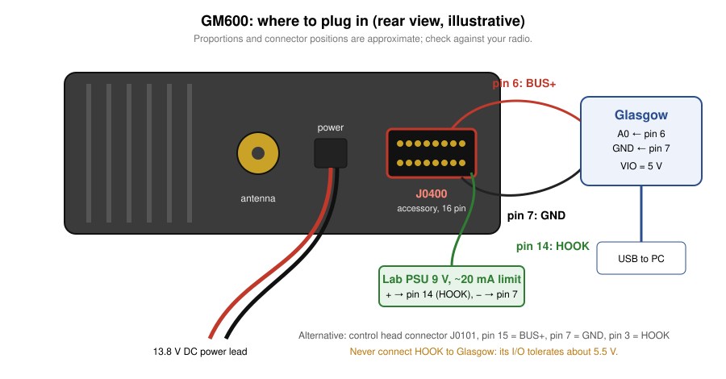
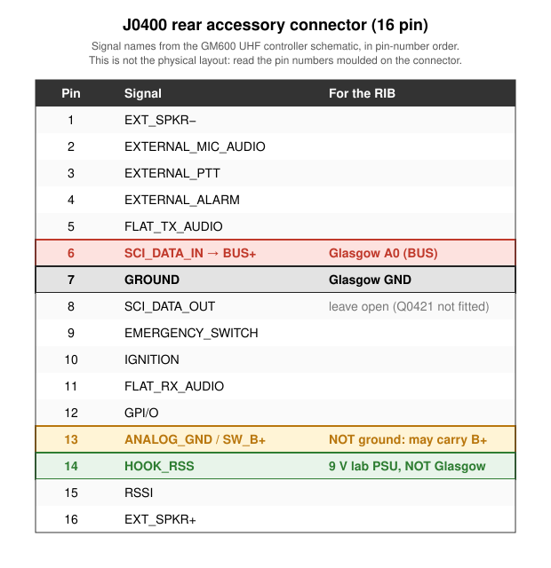
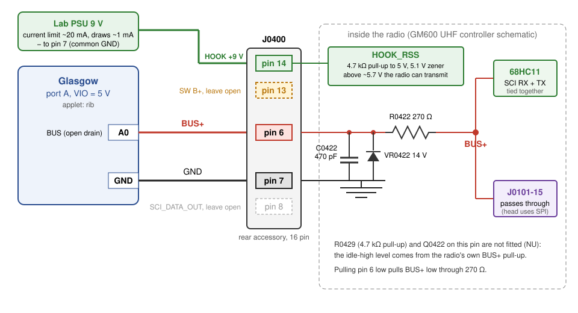

# Connecting the Glasgow RIB to a GM600

How to wire the `glasgow_rib` applet to a GM600 (600 Series, MPT1327 trunked mobile) for
programming. The protocol itself is in [PROTOCOL.md](PROTOCOL.md).

Pin and signal names come from the GM600 UHF controller schematic (`docs/motorola_gm600_uhf_sm.pdf`,
drawing 8402626Y07; crops in `docs/render/`).



## Summary

| Glasgow | GM600 rear accessory connector J0400 |
|---|---|
| A0 (`--bus`) | **pin 6**: SCI_DATA_IN, connected to BUS+ |
| GND | **pin 7**: GROUND |
| (external 9 V supply, not Glasgow) | **pin 14**: HOOK, see [HOOK](#hook-programming-enable) |

- Set Glasgow I/O voltage to **5 V**.
- **Put about 9 V on pin 14 (HOOK).** Without it the radio receives on BUS+ but can't
  answer. This is the only extra part: no level shifter, no diode, no BUSY line.
- The applet drives BUS+ open drain, the same way the radio does.

## J0400 pinout



| Pin | Signal | Notes |
|---|---|---|
| 1 | EXT_SPKR− | |
| 2 | EXTERNAL_MIC_AUDIO | |
| 3 | EXTERNAL_PTT | |
| 4 | EXTERNAL_ALARM | |
| 5 | FLAT_TX_AUDIO | |
| **6** | **SCI_DATA_IN → BUS+** | **RIB data line** |
| **7** | **GROUND** | **RIB ground** |
| 8 | SCI_DATA_OUT | Leave open: driver Q0421 and pull-up R0428 are not fitted |
| 9 | EMERGENCY_SWITCH | |
| 10 | IGNITION | |
| 11 | FLAT_RX_AUDIO | |
| 12 | GPI/O | |
| 13 | ANALOG_GND / SW_B+ | **Not a ground.** May carry switched battery voltage |
| **14** | **HOOK_RSS** | **About 9 V for programming** (see below). Keep it under 12 V: 14 V zener VR0415 |
| 15 | RSSI | |
| 16 | EXT_SPKR+ | |

The physical arrangement of the pins on the connector face is not in the schematic. **Go by
the numbers moulded on the connector**, and confirm with a meter (see below) before you connect
anything.

## What is behind pin 6



```
J0400-6 ──┬──┬── R0422 270 Ω ── BUS+ ──┬── 68HC11 SCI (RX and TX tied together)
          │  │                         └── J0101-15 (passes through to the control head connector)
     C0422  VR0422
     470 pF 14 V
          │  │
GND ──────┴──┴── J0400-7
```

- Pin 6 is BUS+ itself, through a 270 Ω series resistor. A 470 pF capacitor and a 14 V zener
  protect it.
- The radio's CPU sends and receives on the same BUS+ line, so everything on it, including
  your own bytes, is seen by every device. That is why the applet echoes your transmitted bytes
  back.
- The optional 4.7 kΩ pull-up (R0429) and transistor (Q0422) on this pin are marked NU (not
  fitted). The line idles high because of the radio's own BUS+ pull-up, R0130 (10 kΩ to 5 V) on
  the controller, not because of anything on the connector.
- When you pull pin 6 low, the radio sees BUS+ go low through 270 Ω. Against 10 kΩ that is a
  clean low.
- The radio can only transmit on BUS+ while HOOK is high; see the next section.
- BUS+ is quiet in normal use. The control head talks to the CPU over SPI (`SPI_CLCK_BUF`,
  `SPI_DATA_BUF`, `LCD_CE_BUF`, `LED_CE` on J0101) and reports keys through analog resistor
  ladders (`ANALOG_1..3`). Pressing buttons puts nothing on BUS+.

## HOOK: programming enable

HOOK_RSS (pin 14) goes straight to the controller, with only C0415 (470 pF) and a 14 V zener
(VR0415) to ground. On the controller (page 5):

```
+5 V ── R0111 4.7 kΩ ──┬── HOOK_RSS ── Q0101 (hook switch input, active low)
                       └── VR0102 5.1 V ── R0120 47 kΩ ── Q0105 ──┬── Q0104 → Q0106 → CPU IRQ
                                                                  └── Q0122: enables the BUS+ TX driver
```

- Q0105 only turns on when HOOK is above about **5.7 V**, which normal logic can't reach. That
  is how the radio detects a RIB.
- The radio's BUS+ transmitter (SCI_TX → Q0123 → Q0121) is held off by Q0122 unless Q0105 is
  on. So **with HOOK at 5 V the radio hears you but never answers**: you get your echo and no
  ACK.
- A lab supply straight onto pin 14 works: **9 V, current limit 10–20 mA**, negative lead to
  pin 7. It draws about 1 mA, mostly back through R0111 into the radio's 5 V rail. A 1 kΩ series
  resistor from a 9 V battery works too.
- **Never connect HOOK to a Glasgow pin.** Glasgow I/O tolerates about 5.5 V.
- Stay under 12 V, or VR0415 starts to conduct.

## Before you connect: check with a meter

With the radio **off**:

1. Pin 7 to chassis: about 0 Ω.
2. Pin 6 to control head connector J0101-15 (or to the BUS+ test point): about 270 Ω. This
   confirms R0422 is fitted on your board variant.

With the radio **on**:

3. Pin 6 to pin 7: about 5 V. The bus is idle unless you are programming.
4. Pin 14 to pin 7: about 5 V (R0111 pull-up), before you connect the 9 V supply.
5. Pin 13 to pin 7: if it reads battery voltage, keep well away from it.

## Running the applet

See [README.md](../README.md#install) for installing and running the applet. For the GM600, keep
the default baud rate (9600, the only one the 600 Series uses) and leave `--busy` off.

`sniff` shows nothing on an idle radio, so it can't check the wiring. Instead, with HOOK at 9 V,
run `glasgow run rib -V 5 --bus A0 socket tcp:localhost:2600` and send `F1 10 FE` (enter
programming mode). The radio answers `50` (ACK) right after the echo and then resets; see
[PROTOCOL.md](PROTOCOL.md#confirmed-on-a-gm600).

To tell whether a pin is BUS+ without a meter, sample it with Glasgow's pull-down on:
`glasgow run control-gpio -V 5 --pins A0 A0=L A0`. BUS+ reads `1` (R0130 beats the pull-down),
an unconnected pin reads `0`. Other inputs with pull-ups also read `1`, so this only rules pins
out.

## Alternative: control head connector J0101

BUS+ is also passed through to the internal control head connector J0101:

| J0101 pin | Signal |
|---|---|
| 15 | BUS+ |
| 7 | GND |
| 18 | ON_OFF_CONTROL (control head service request, see below) |

J0101 has HOOK_RSS too (pin 3), so the same 9 V rule applies there.

The GM600 control head is not on BUS+: it uses SPI and the analog key lines on the same
connector (see above). Emulating it would mean driving SPI, not SBEP.

## Unverified

- Physical pin positions on J0400 (use the moulded numbers).
- That R0422 is fitted on every board variant (check step 2 above).
- The exact HOOK threshold. About 9 V works; it's about 5.7 V on paper.
