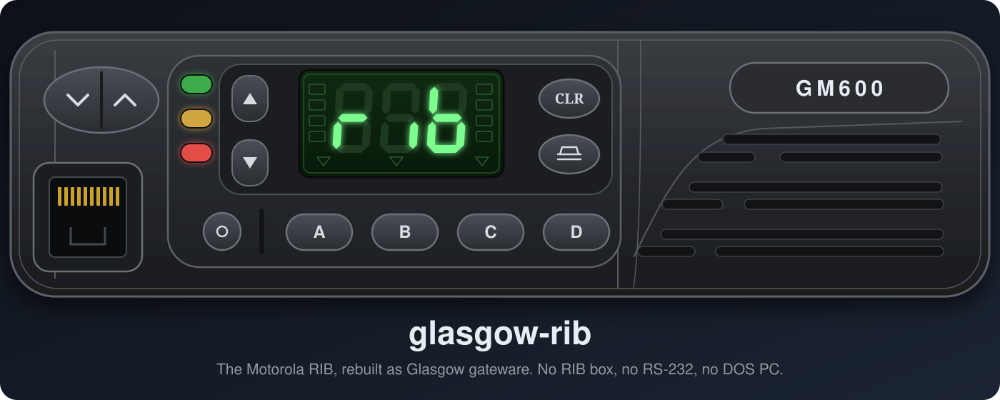
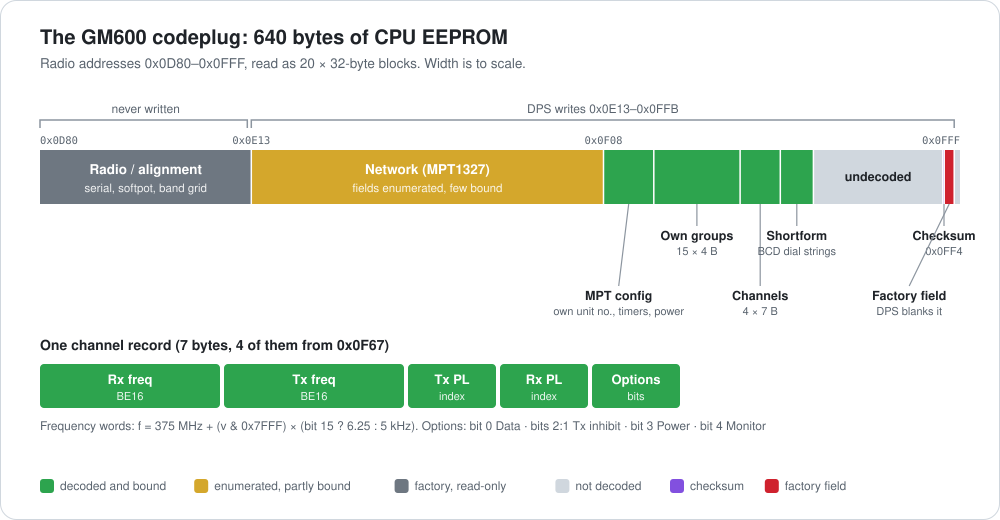

  

# Motorola GM600

Everything specific to the GM600 (600 Series, MPT1327 trunked mobile): wiring, the programming
protocol, the codeplug format, firmware notes and host tools. The applet itself is generic; see
the [top-level README](../README.md).

**With a Glasgow, three wires and a bench supply you can read and write a GM600's codeplug: no
RIB, no DPS, no period PC.** Motorola's own Dealer Programmer also runs against the radio through
the applet, under QEMU.

## What you can do

| | |
|---|---|
| 📥 **Back up a radio** | Dump the whole 640-byte codeplug in seconds, every reply checksum-verified |
| 🔍 **Read it** | Channels, PL tones, MPT identity, timers, power and per-channel options, decoded with a Kaitai spec |
| ✏️ **Write it** | Proven on a real radio; see the checksum caveats below before writing changed data |
| 🖥️ **Run the original DPS** | 16-bit Windows 3.1 DPS in QEMU, its COM1 bridged to the applet socket |
| 🔬 **Reverse further** | Firmware memory map, SBEP dispatch table, DPS binary offsets and probe methods |

## Quick start

1. **Wire it** ([CONNECTION.md](CONNECTION.md)): Glasgow A0 → J0400 pin 6 (BUS+), GND → pin 7, and
   a bench supply at 9 V (current limit 10–20 mA) → pin 14 (HOOK), its negative to pin 7.
2. **Start the applet:** `glasgow run rib -V 5 --bus A0 socket tcp:127.0.0.1:2324`
3. **Dump:** `python3 tools/dump_codeplug.py my-radio.bin`, and keep that first dump.
4. **Decode:** open the dump with [gm600_codeplug.ksy](gm600_codeplug.ksy) in the
   [Kaitai Web IDE](https://ide.kaitai.io/).

  

## Docs

| File | Contents |
|---|---|
| [CONNECTION.md](CONNECTION.md) | Wiring, the J0400 pinout, what's behind BUS+ and HOOK, meter checks |
| [PROTOCOL.md](PROTOCOL.md) | SBEP framing and commands, timings, and the DPS read/write sequence captured from a real radio |
| [CODEPLUG.md](CODEPLUG.md) | The 640-byte codeplug: block map, channel table, PL tones, identity, option bits, checksums |
| [DPS_GUI_MAP.md](DPS_GUI_MAP.md) | The vendor Dealer Programmer's full menu tree: which dialogs edit radio data, which are view-only / password-gated, reference-radio values |
| [gm600_codeplug.ksy](gm600_codeplug.ksy) | Kaitai Struct spec for the codeplug, with editor write support |
| [FREQ_ENCODING.md](FREQ_ENCODING.md) | Stored word ↔ frequency: `375 MHz + (v & 0x7FFF) × (bit 15 ? 6.25 : 5 kHz)`, and its pitfalls |
| [DUMP_SEQUENCE.md](DUMP_SEQUENCE.md) | How to dump, the probe methods used to find the codeplug, and DPS binary references for reversing |
| [FIRMWARE.md](FIRMWARE.md) | 68HC11 memory map, flash banking, SBEP dispatch table, routes to a full flash dump |
| [HARDWARE.md](HARDWARE.md) | Accessory connector reference and repeater tap points (COR, PL, flat audio) |
| [FAQ.md](FAQ.md) | Operating the radio from the front panel: entering conventional mode, channel select, squelch/PL, what the display shows |
| [tools/](tools/README.md) | `dump_codeplug.py`, `sbep_client.py`, `sbep_write.py` on a shared `sbep.py`; `mock_radio.py` for testing without a radio; the QEMU + DPS capture rig |
| [assets/](assets/) | Diagrams; `make_diagrams.py` regenerates the codeplug map and session diagrams |

## Status (2026-11-04)

- **Working:** read and write over BUS+, verified on a real radio (serial `807IYA0903`).
  Conventional channels, PL tones, MPT identity, per-channel option bits and timers are decoded.
- **The codeplug is the CPU's 640-byte internal EEPROM, `0x0D80`–`0x0FFF`.** There is no separate
  personality region. DPS writes only `0x0E13`–`0x0FFB`.
- **Codeplug checksums are solved:** five per-block additive sums, `checksum = (Σ data − 0x55) & 0xFF`
  (firmware-verified; see [CODEPLUG.md](CODEPLUG.md)). `tools/gm600_codeplug.py` computes and fixes
  them, and `tools/sbep_write.py` verifies/repairs before a write, so edited codeplugs can be written
  without DPS rejecting the radio on the next read.
- **Not decoded:** the MPT1327 network block (`0x0E13`–`0x0F07`, fields enumerated but not
  byte-bound) and the factory alignment area.
- **Firmware flashing is a separate, untried problem** (68HC11 bootstrap via MODA/MODB, or writing
  the flash — a 5 V Atmel AT29C020, so no VPP needed; see [FIRMWARE.md](FIRMWARE.md)).
- **Keep a pre-write dump.** DPS blanks the factory field at `0x0FF5`–`0x0FFB` on every write, and
  it can't be recovered from the radio afterwards.
