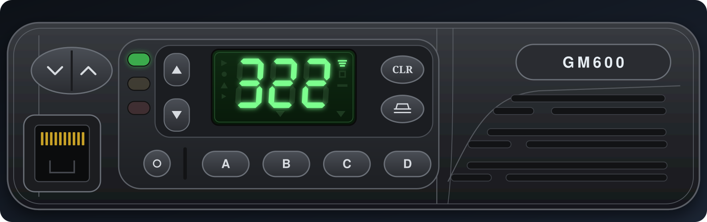

# GM600 SBEP tooling

Host-side tools that talk to a GM600 through the applet's `socket` operation
(`glasgow run rib -V 5 --bus A0 socket tcp:127.0.0.1:2324`). They speak raw SBEP and account
for the applet's echo. Validated on a real GM600 (serial `807IYA0903`), 2026-11-03.

Prereqs: 9 V on HOOK (see [../CONNECTION.md](../CONNECTION.md)); the applet listening on `2324`;
**nothing else connected to `2324`** — it serves one client at a time (see "Capture rig" below).

## `sbep.py` — shared framing and client

The SBEP codec from [../PROTOCOL.md](../PROTOCOL.md) (`encode`, `decode`, `frame_length`,
`checksum`) and a `Radio` socket client that every tool uses. `Radio.transact(frame)` sends one
frame and checks it end to end: the echo must match what was sent (a mismatch means a collision),
then the status byte (`50` ACK, `60` NAK, bare `80` refused), then the reply frame's checksum. It
raises `SBEPError` on any problem instead of returning partial data. The echo and the reply each
get their own deadline, by default DPS's write-result timeout (`1 s + 12 ms × frame length`);
pass `timeout=` for anything slower.

```python
from sbep import Radio, encode
with Radio() as r:                         # SBEP_ADDR=host:port, default 127.0.0.1:2324
    print(r.id_string(1))                  # "807IYA0903"
    data = r.read_block(0x0F60, 0x20)      # checks the echoed address too
    status, op, data = r.transact(encode(0x13))
```

## `sbep_client.py` — read-only

Queries the serial (`23 01`) and reads 32 bytes at `0x0F60` (the channel region). A starting point
for your own scripts.

Opcodes confirmed live: `23` ID query, `11` block read, `13` max-block, `10` enter/reset,
`17` write (→ `84` OK / `85` fail). ACK = `50`.

## `sbep_write.py` — write-probe (DANGER: writes the radio)

Replays DPS's captured write stream (a socat sniff log, default `sniff-write.log` in the current
directory, or the path given after the mode) **verbatim**, optionally patching a few bytes, so one
session writes a complete, valid-framed codeplug with a controlled change. Modes:

- *(default)* dry run — parse + print, send nothing.
- `--restore` — replay the stream unmodified → returns the radio to the **captured (post-DPS)
  baseline**, which is the safe undo for a probe session. Note it is *not* the factory original:
  DPS's captured write had already cleared `0x0FF5`–`0x0FFB` (`20 00 00 00 00 11 DC` → `FF`), so
  replaying it keeps those `FF`. The factory bytes live only in the pre-write dumps (see
  [../CODEPLUG.md](../CODEPLUG.md)).
- `--write` — send the patched stream. `PROBE_SET=<name>` picks the patch table (see the top of the
  file); an unknown name is an error.
- `--fix` / `--force` (with `--write`) — see the checksum guard below.

Every frame is checked like DPS would expect: matching echo, ACK, and for each `17` a result frame
`84` for the same address. **The stream aborts on the first failure**, so a failed or unanswered
block is never followed by more writes; the radio may then be partly written, and the message says
to run `--restore` once the cause is fixed. `--write` also refuses to send anything if the capture
doesn't contain every address in the chosen `PROBE_SET`.

**Checksum guard.** Before a `--write`, the tool reconstructs the resulting codeplug (the radio's
current image + the pending writes) and verifies all five block checksums (`gm600_codeplug.py`). A
write that would leave any block wrong is **refused with nothing sent** — DPS would otherwise reject
the radio on its next read. `--fix` corrects them instead (it appends `0x17` writes for the affected
checksum bytes); `--force` sends anyway. Some probe sets (`balanced`, `bits012f`, `bits012p`) are
block-neutral — a changed byte balanced by an opposite change *in the same block* — and pass the
guard untouched; the rest are raw bit-isolation probes that leave a checksum wrong (and some tweak
`0x0F06`, which is in the Network block, not Personality), so they need `--fix`. The guard is what
makes an arbitrary, net-nonzero edit safe to write. Off-step frequencies or an Inhibit-with-PL combo
are still rejected by DPS as invalid *values*, independent of the checksum.

The patch addresses in `sbep_write.py` are specific to this radio's layout and its captured
`sniff-write.log`; adapt both for another radio/codeplug.

## `gm600_codeplug.py` — codeplug checksums

The five per-block additive checksums, reversed from the firmware validator (`(Σ data − 0x55) & 0xFF`;
see [../CODEPLUG.md](../CODEPLUG.md)). Importable — `verify_checksums(cp)` returns the mismatching
blocks, `fix_checksums(cp)` rewrites all five in a 640-byte buffer — and a CLI:

```
python3 gm600_codeplug.py my-codeplug.bin             # report each block OK / MISMATCH
python3 gm600_codeplug.py edited.bin --fix out.bin    # repair the checksums into out.bin
```

Any tool that edits the codeplug (an open CPS, a field patch) recomputes the affected block here
before writing it back; `sbep_write.py`'s guard uses it directly.

## `dump_codeplug.py` — full read-back

Reads all 640 B (`0x0D80`–`0x0FFF`) via `0x11` and writes a .bin. Diff two dumps (baseline vs a
DPS-written change) to bind fields: `cmp`/Python diff shows exactly which native bytes a GUI option
moved. This is how Monitor was bound (ch1 Monitor=Yes → only `0x0F6D 08→18` and checksum `0x0FF4`
changed). Reply header is `FF 80 00 24 <ah><am><al>` then 32 data bytes and the checksum.
`00 24` is the 16-bit length; the next byte is the high address byte, which is also `00` here, so
it's easy to be off by one.

## `ramdump.py` — full 256 KB flash dump (DANGER: uploads & runs code)

Dumps the **whole external flash** (U0102, all 16 banks), not just the mapped one. The SBEP `11`
read only sees the bank at `0x4000`, and a bank-walk can't work (the `11`/`17` handlers run from
that banked window). So this uploads a 73-byte **68HC11 stub into RAM** with `0x17` writes, launches
it with the `0x26` backdoor (`sei` + `jmp`), and the stub streams all 256 KB out the SCI — each
banked page, then the fixed `0x8000`–`0xFFFF`. It does **not** return; power-cycle when done.

```
python3 ramdump.py flash.bin               # ~4.5 min at 9600; then power-cycle the radio
python3 ramdump.py radio.bin --with-eeprom  # append the 640 B internal EEPROM = complete NV image
```

`ramdump.py` dumps the **external** flash only. The CPU-internal EEPROM (the 640 B codeplug at
`0x0D80`) is separate — `dump_codeplug.py`, or `--with-eeprom` to tack it onto the flash image
(bytes `0x40000`–`0x4027F`). There is no internal mask ROM active (FIRMWARE.md), so those two
stores are the radio's whole non-volatile state.

The stub is `ramdump.S` — readable 68HC11 assembly with the register map as a small HAL (equates)
— assembled by `asm6811.py`, a tiny bundled 6811 assembler (`python3 asm6811.py ramdump.S` prints
the bytes). No external toolchain. **Verified in-circuit on `807IYA0903`: the output is byte-for-byte
identical (same SHA-256) to the off-board T48 read (`motofix.BIN`), all 16 pages.**
`test_tools.py::RamdumpAssemblerTest` checks the assembler reproduces the verified stub from the
`.S`, no hardware needed. The `0x26` jump runs arbitrary code with interrupts off — only ever launch
the address you just uploaded.

## `flashtool.py` / `flashtool.S` — AT29C020 probe / read / **program** (DANGER)

ramdump's read-write sibling. Where `ramdump` streams the flash and halts, `flashtool` uploads a
**resident** command stub (`flashtool.S`, via `0x17` + `0x26`) and drives it over the raw link to
probe the chip, read a sector, or **program** one — enough to apply/revert the keypad firmware patch
(see [../FLASH_WRITE.md](../FLASH_WRITE.md), [../FIRMWARE.md](../FIRMWARE.md)).

```
python3 flashtool.py probe                 # SAFE: AT29C020 ID (1F/DA) + boot-block lockout
python3 flashtool.py read 0x1000 out.bin   # read the 256-byte sector at a device address
python3 flashtool.py patch flash.bin       # apply the keypad patch (2 sectors, read-back verified)
python3 flashtool.py revert flash.bin      # restore the original bytes
```

**In-circuit flash write needs ~12 V on accessory pin-12** (releases the `/OE` write-lock so it
follows PA6; see [../FLASH_WRITE.md](../FLASH_WRITE.md)). `probe`/`read` are safe; `patch`/`revert`
ERASE AND PROGRAM, refuse unless `probe` reports an AT29C020 with the boot blocks unlocked, program
the stub sector before the read_adc jsr sites, and read-back-verify.

The stub encodes the bank register as **`page<<2`** (`aslb;aslb`), matching `ramdump.S`. An earlier
raw-page bug sent a "page 13" write to page 3 and bricked a radio — see
[../RECOVERY.md](../RECOVERY.md). Guards added after that: `write_sector` always reads and
**auto-backs-up the live sector** to `flash_backups/` before programming, and `require_erased=True`
refuses a test write unless the live sector is all-FF. Chunked transfer (32-byte bursts, drain each
echo) fixes the applet link-drop on a 256-byte write.

**Validated on the radio** (12 V on pin-12): probe `1F DA FE FE`, a page-13 (`0x34000`) write +
read-back with **`0xC000` left untouched** (proves the bank fix), then restored to FF — run by
`flash_write_test.py`. The full keypad-patch apply is validated in the emulator, which models the
write path including `page<<2` (`test_tools.py::VmFlashWriteModelTest`,
`FlashStubIntegrationTest::test_nonzero_page_bank_encoding`). `../datasheets/` holds the AT29C020 and
68HC11K4 datasheets (gitignored).

## `flash_write_test.py` — on-hardware bank-fix validation (needs 12 V on pin-12)

Uploads the fixed stub and, with 12 V applied, writes page 13 (`0x34000`), verifies the read-back,
asserts page 3 (`0xC000`) is unchanged (the `page<<2` proof), and restores `0x34000` to FF. Safe:
page 13 is erased, `require_erased` enforces it, and every write is auto-backed-up. Boot with 12 V
OFF, then apply 12 V; if the probe reads `0F CE…` the 12 V isn't effective. Radio is halted after —
power-cycle. See [../RECOVERY.md](../RECOVERY.md) "Post-recovery validation".

## `emu6811.py` and `asm6811.py` — firmware emulator + assembler

`asm6811.py` is a tiny 68HC11 assembler (used by `ramdump.S`). `emu6811.py` is a 68HC11 **core
emulator** that runs the GM600 firmware in software — the goal being to reverse the display and
build remote control by *executing* the firmware, not just reading disassembly.

```
python3 emu6811.py                         # CPU self-test (no firmware)
python3 emu6811.py motofix.BIN eeprom.bin  # boot the firmware, dump the display SPI transfers
```

State: the CPU core is validated (millions of firmware instructions, no opcode faults) and the
firmware **boots** — reset vector `0xD45A`, through init (with the deliberate COP-watchdog resets
it uses; RAM is battery-backed), into its main loop where it **kicks the COP and drives the LCD
over SPI**. The emulator captures every SPI/SCI transfer (`mem.spi_xfers`), so the display output
is observable. Memory model: RAM, registers (bank `0x1058`, SPI/SCI captured, ADC stubbed), the
internal EEPROM, and the banked + fixed flash from the 256 KB image. The firmware image
(`motofix.BIN`) is Motorola's and is **not** in the repo — supply your own dump (see `ramdump.py`).
Next: find the displayed-number variable and decode the digit encoding, then inject a scheduler
task (unused OC ISR RAM pointers `$A4`/`$A6`) for remote control. `test_tools.py::EmulatorTest`
checks the core, no firmware needed.

## `gm600_vm_bridge.py` — the emulated radio as a serial SBEP endpoint

Where `mock_radio.py` synthesises replies from an image, `gm600_vm_bridge.py` runs the **actual GM600
firmware** for the one opcode that benefits: it boots `motofix.BIN` in the `emu6811` emulator and
serves SBEP on a socket. For an identity query (`0x23`) the VM *is* the radio — it receives and
validates the frame and builds the authoritative reply in its own RAM, which the bridge reads back
out (the final byte-out the firmware's RTOS TX task would do, which the cooperative scheduler doesn't
dispatch in emulation). The other opcodes are bridge logic over the VM's EEPROM image, **not** the
firmware's own handlers: reads (`0x11`) come from that EEPROM, writes (`0x17`) apply to it (range-
checked to the 640-byte codeplug, so an out-of-range write is refused rather than silently growing or
wrapping the image), `0x13` is the hardcoded transfer constant, `0x10` ACKs. Enough for DPS/NPS and a
dump/write round-trip; not a full firmware-in-the-loop radio.

```
python3 gm600_vm_bridge.py ../../motofix.BIN my-codeplug.bin 2399   # ~75 s to boot, then listens
# then SBEP_ADDR=127.0.0.1:2399 for any tool, or bridge it to a DPS/NPS VM like the mock below
```

Verified end to end: `sbep_client` → serial `807IYA0903` (VM-computed), `dump_codeplug` → 640 B
byte-identical to the source in ~1 s, and a `0x17` write round-trips (write `AA…`, read back `AA…`).
Boot is a one-time ~75 s; each `0x23` runs the VM briefly; reads/writes are instant EEPROM ops. Use
this when you want real-firmware behaviour (frame validation, firmware-computed query replies); use
`mock_radio.py` when you just want a fast image-backed radio.

## `gm600_remote.py` — read the radio's screen (and press keys)

Remote-control the control head over the wire. The firmware renders the icons into a 21-byte shadow
buffer in RAM at `0x37AC` and caches the three 7-seg digit bytes at `0x3497` (see `lcd_text.py`; the
digits are NOT in `0x37AC` — the old byte split below came from the emulator and is wrong for the
digits), with an LED shadow at `0x34AE`,
and SBEP `0x11` reads any address on a running radio — so `read_screen()` mirrors the live display
without prog mode or hardware mods. The digit/icon byte split was reversed in the emulator (see
`gm600_remote.py` header). Two backends, same decode:

```
python3 gm600_remote.py --radio            # the real GM600 (SBEP_ADDR); --mirror to poll continuously
python3 gm600_remote.py --emu ../../motofix.BIN my-codeplug.bin line1   # the emu6811 VM, for dev
```

Pressing buttons is honest about hardware: the keypad is an analog A/D ladder the firmware
re-samples every cycle, so there is **no clean serial keypress** on the real radio (a `0x17` RAM
poke is overwritten before the round-trip lands, and GM600 firmware exposes no keypad-inject opcode)
— real injection needs the keypad line driven in hardware or a RAM-stub takeover. The `--emu`
backend presses for real by setting the A/D levels.

## `lcd_text.py` / `lcd_text.S` — write arbitrary text on the 3-digit display

RAM stub (upload `0x17`, launch `0x26`) that calls SPI-dispatcher entry 5, the 7-seg digit controller,
with host-supplied segment bytes. Cam-proven on the radio. Halts the firmware: recover with
`psu_reboot.py`.

```
python3 lcd_text.py HI                      # upload + launch, show "HI"
python3 lcd_text.py --no-launch --scroll HELLO 322   # stub already running: scroll text
python3 lcd_text.py --no-launch --raw e67676         # raw segment bytes (here "322")
python3 lcd_text.py --standalone --backlight 53X     # lcd_raw.S: own SPI driver, no firmware code
python3 lcd_text.py --standalone --icons 0040 322     # icon bytes b0b1 (default 0000 = icons off)
python3 lcd_photos.py /tmp/out [--only wire|struct|glyphs]  # photograph every segment (webcam)
```

`lcd_raw.S` drives the display controller and the LED/backlight shift register itself; the host sends
the 10 wire bytes (`lcd_text.pack` ports the firmware's packing). Commands are checksummed and the stub
replies `06` ok / `15` bad checksum / `54` SPI timeout (`lcd_text.command` raises on anything but `06`).
Loads at `0x3E40` (not `0x2000`, which is live firmware RAM). Maps, photos, and the framing
experiment (start bit + 33 data bits): `../images/lcd_segments/`.

## `gm600_display.py` and `gm600_vm_bridge.py --ui` — see the emulated control head



`gm600_display.py` models the display controller (start bit + 33 data bits, partial frames carry
over), taps an `emu6811.Mem`'s SPI/chip-select writes (display frames on select `0x61`, the LED byte
latched by the `0x21` strobe), and draws the result with the banner's front panel
(`../../assets/make_banner.py`, `panel_svg()`): digits, 9 icons, the 3 LEDs and the backlight.

```
python3 gm600_vm_bridge.py motofix.BIN codeplug-640.bin 2399 --ui     # then open http://127.0.0.1:8600/
python3 gm600_display.py --text 53X --icons 0040 --backlight out.svg  # static preview
```

`--ui[=PORT]` keeps the firmware running between SBEP queries so its display task refreshes; the
page polls `/display.svg` and `/state.json`. The codeplug must be the 640-byte EEPROM image
(`0x0D80`–`0x0FFF`). The VM boots to the idle own-ident screen like the radio (322 on the bench
codeplug), with the LEDs and backlight live. **Click the panel's buttons** (or the raw key-code row) to
press keys: the bridge drives the keypad A/D ladders the firmware decodes ([idle, C, scroll up](../images/vm_ui_buttons.png)).

Keypad (firmware decoders `0x4FBB`/`0x4F79`/`0x4FFD`, one per A/D ladder; windows ≤`29`, `39`–`48`,
`79`–`88`, `B9`–`C8`). Button names come from what each code does in the VM; not yet checked by
pressing the bench radio:

| ladder | codes → buttons |
|--|--|
| AN0 | `10` vol down · `11` vol up · `12` clear · `13` base call |
| AN1 | `14` A · `15` B · `16` C · `17` D |
| AN2 | `06` scroll down · `07` scroll up · `08` on/off |

## `ctcss_tx.py` / `squelch_test.py` — open a conventional channel's tone squelch (HackRF)

```
python3 ctcss_tx.py                         # 446.06875 MHz, PL 123.0 Hz + 1 kHz audio, Ctrl-C to stop
python3 ctcss_tx.py --no-tone --seconds 10  # same without PL: a PL channel must stay squelched
python3 squelch_test.py --out /tmp/sqt      # baseline / no PL / PL / off, logs LEDs + display + webcam
```

Narrowband FM (2.5 kHz audio deviation, 500 Hz PL), HackRF tuned 250 kHz below the channel so its LO
leak is out of band, amp off. The generator self-checks its IQ by
FM-demodulating it (`CtcssTxTest`). Put the radio on the conventional channel first with
`keyhold.py` (or a ~7 s hand-hold of A). Defaults: TX VGA 35, `--cal-hz 2500` (bench HackRF).

## `gm600_live.py` — live web front panel for the REAL radio

```
python3 gm600_live.py                      # on the lab PC (owns the SBEP link): http://127.0.0.1:8600/
ssh -L 8600:127.0.0.1:8600 <lab>           # then open http://127.0.0.1:8600/ locally
python3 gm600_live.py --host 0.0.0.0       # or listen on the LAN
```

Same page as `gm600_vm_bridge.py --ui`, but the radio: display (icons + digits) from the struct the
firmware caches at `0x3495`, LEDs/backlight from `0x34AE`, RX state (`0x347E`/`0x347F`) on the status
line, ~3 reads/s. Click = tap, mouse-hold = hold (a 7 s hold of A switches trunked ↔ conventional; the
radio re-runs its self-test, which the server rides out). Single SBEP client: stop it before running
other SBEP tools. Ctrl-C releases any held key and resumes the keypad task.

## `keyhold.py` / `keyevt.S` — press and hold a key remotely (no flash patch)

```
python3 keyhold.py                         # long-hold A 9 s -> conventional mode (322 -> ---  ->   1)
python3 keyhold.py --event 23 --hold 0.5   # tap D (events: 16-19 vol-/vol+/clear/call, 20-23 A-D, 6-8 scroll-/scroll+/on-off)
```

Pauses the keypad task (bit `0x10` in TCB flags `0x11D8`), posts the key event with the non-halting
`keyevt.S` stub (launched via `0x26`, calls the firmware's `0x4D8B`, returns into the firmware), then
releases and resumes. RAM only; the radio keeps running. Receive flags to watch afterwards:
`0x347F` carrier, `0x347E` PL decoded / RX active.

## `gm600_keypad_patch.py` — press real keys via a firmware patch

Reading the screen is easy; *pressing* a key is not — the keypad is an analog A/D ladder the
firmware re-samples every poll, so there's no RAM variable to poke (see
[../FIRMWARE.md](../FIRMWARE.md), "Remote keypress"). This patches the **source**: the one `read_adc`
instruction that reads the keypad channel becomes a `jsr` to a 13-byte stub that returns a
host-controlled RAM value when armed, else the real A/D. The whole real keypad path then runs for a
host-supplied level, so a press is identical to a finger — validated in the emulator byte-for-byte
against a physical press.

```
python3 gm600_keypad_patch.py --patch flash.bin out.bin   # produce a patched flash image + byte diff
# then, against a running patched radio (import the module):
#   from sbep import Radio; import gm600_keypad_patch as kp
#   with Radio() as r: kp.arm(r); kp.press(r, LEVEL); ...; kp.release(r)
```

`press`/`release` are SBEP `0x17` writes to two RAM control bytes (`0x028B`/`0x028C`); `LEVEL` is the
A/D value that key's ladder produces (characterise per radio). Applying/reverting the patch on a real
radio is an AT29C020 in-system sector write — `patch_diff()` gives the exact bytes.

## `mock_radio.py` and `test_tools.py` — no hardware needed

`mock_radio.py` is a fake GM600 behind a fake applet socket: it echoes, ACKs, and answers `23`
(ID), `13` (block size), `11` (reads from an EEPROM image), `17` (writes) and `10` like the real
radio, refuses reads over 64 bytes, and NAKs anything it can't parse instead of dying. One thread
per connection, so a VM serial with auto-reconnect can't wedge it. A 640-byte image is served as
the codeplug (base `0x0D80`); a larger dump (e.g. the 4096-byte low EEPROM) is served from `0x0000`.

```
python3 mock_radio.py dump.bin 2399        # then SBEP_ADDR=127.0.0.1:2399 for any tool
```

**It is faithful enough that Motorola's own DPS reads it.** Its reply bytes are identical to a real
radio's, verified against a capture (`test_tools.py::DPSReadTest`), so you can load a saved codeplug
into DPS with no hardware — then browse or edit it (including fields we never byte-bound in the raw
codeplug, like the trunking/conventional mode, which DPS knows how to pack) and Save a `.rad`. To do
it, point the mock at the DPS VM's COM1 the same way the applet is bridged (see the capture rig
below) and run **File → Read Radio → All**. Proven end to end: DPS reported *"Successfully
completed"* and showed the real model `M08RHF4CK3` reading a dump through the mock.

```
# in two tmux windows so they survive SSH logout (systemd kills bare background jobs):
tmux new -d -s mock   'python3 gm600/tools/mock_radio.py my-dump.bin 2324'
tmux new -d -s bridge 'socat TCP-LISTEN:2323,reuseaddr,fork TCP:127.0.0.1:2324'
# QEMU serial is a reconnecting client to 2323 (see below); then Read Radio in DPS.
```

`test_tools.py` uses the mock to test the codec and every tool (including DPS's exact read sequence
and a write stream aborting on a failed block): `python3 -m unittest test_tools`.

## `mouse_ctl.py` — closed-loop headless mouse (now working)

Drives the guest cursor via the QEMU monitor: `find` locates it by diffing framebuffers after a
nudge (masking the blinking caret), `move`/`click`/`dbl` converge to a target. Two things made it
reliable: (1) `WIN.INI [windows] MouseSpeed=0` in the guest (disables acceleration → ~1:1 relative
motion); (2) **pacing** monitor commands (QEMU's HMP silently drops bursts of piped lines — send
one per ~60 ms). With both, `click X Y` lands within a couple of px. This is what finally let us
toggle DPS grid combos (open Monitor dropdown, click "Yes") headlessly.

## Capture rig (driving real DPS headless through the applet)

To capture the exact DPS read/write protocol or to generate codeplug contrast, run the 16-bit
Dealer Programmer under QEMU with COM1 bridged to the applet:

1. **Win3.11 image** with DPS injected (`WDPS_DP.EXE` → `C:\DPSWDP`, auto-launched via
   `WIN.INI [windows] run=`).
2. **QEMU**, serial as a reconnecting TCP client, monitor on a unix socket, headless VNC:
   ```
   qemu-system-i386 -m 64 -drive file=msdos.raw,format=raw -vga std -display none \
     -vnc 127.0.0.1:1 -monitor unix:/tmp/qmon,server,nowait \
     -chardev socket,id=ser0,host=127.0.0.1,port=2323,reconnect-ms=2000 -serial chardev:ser0
   ```
3. **Bridge** QEMU's serial to the applet (and sniff it):
   `socat -x -v TCP-LISTEN:2323,reuseaddr,fork TCP:127.0.0.1:2324 2>sniff.log`
4. **Drive DPS** via the QEMU monitor: `echo "sendkey alt-f" | socat - UNIX-CONNECT:/tmp/qmon`,
   `screendump /tmp/s.ppm` for state. `Read Radio` = Alt+F, R, All, Alt+R; `Edit → Conventional
   Personality` = Alt+E, C.

**Single-client socket:** the applet's `socket` accepts one consumer at a time. The bridge (for
DPS) and `sbep_*.py` (direct) can't both hold `2324`. To write with the scripts while DPS is
bridged, stop the bridge first (free `2324`), run the script, then restart the bridge — QEMU's
`reconnect-ms` re-attaches on its own. Keep QEMU and the bridge in `tmux` (or a user service) so
they survive your SSH session; a bare `nohup`'d QEMU is killed by `systemd` session cleanup on
logout.

**Headless input (solved):** keyboard menu/dialog nav works via `sendkey`. The mouse works too once
you (1) set `MouseSpeed=0` in the guest `WIN.INI` and (2) **pace** monitor commands (~60 ms apart —
HMP drops bursts). Grid combos won't change via injected *keystrokes*, but a real mouse *click*
(`mouse_ctl.py`) does. So per-channel options can be edited headlessly to generate write-contrast.

If the guest cursor seems stuck at 0,0, check for two QEMU instances running at once (commands go
to the wrong one) and for unpaced monitor commands. Both looked exactly like a dead mouse.
